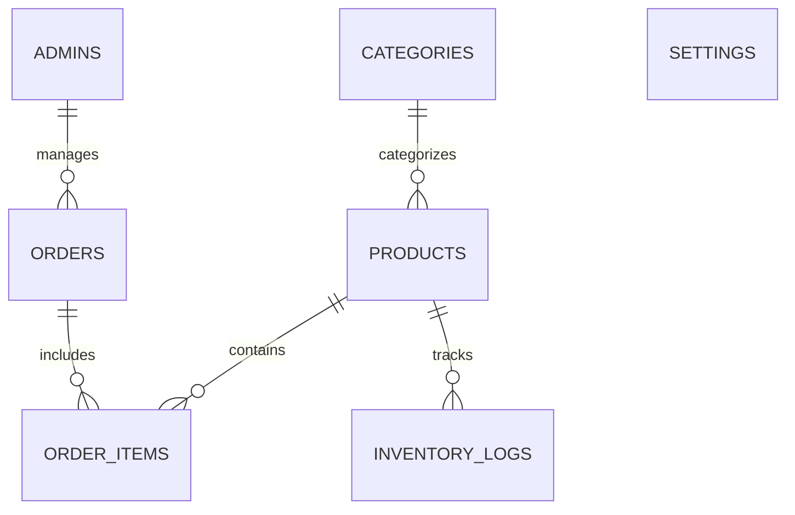

# Al Muheet Fragrance — Database Schema Reference

---

## 1. Relational Entity Overview

---

## 2. Table Definitions

### 1. `settings`
Stores configurable store parameters, branding, and shipping rules.
- `key_name` (VARCHAR 100, PK)
- `value_text` (TEXT)
- `created_at` (TIMESTAMP)
- `updated_at` (TIMESTAMP)

### 2. `admins`
Administrator accounts with bcrypt hashed passwords.
- `id` (INT AUTO_INCREMENT, PK)
- `name` (VARCHAR 100)
- `email` (VARCHAR 150, UNIQUE)
- `password` (VARCHAR 255)
- `role` (VARCHAR 50)
- `last_login` (DATETIME)
- `created_at` (TIMESTAMP)

### 3. `categories`
Olfactory fragrance families.
- `id` (INT AUTO_INCREMENT, PK)
- `name` (VARCHAR 100)
- `slug` (VARCHAR 120, UNIQUE)
- `description` (TEXT)
- `image_url` (VARCHAR 255)
- `is_featured` (TINYINT 1)
- `created_at` (TIMESTAMP)

### 4. `products`
Handcrafted fragrance flacons.
- `id` (INT AUTO_INCREMENT, PK)
- `name` (VARCHAR 150)
- `slug` (VARCHAR 180, UNIQUE)
- `category_id` (INT, FK -> categories.id)
- `short_description` (TEXT)
- `description` (TEXT)
- `price` (DECIMAL 10,2) in PKR
- `compare_at_price` (DECIMAL 10,2)
- `stock_quantity` (INT)
- `sku` (VARCHAR 60, UNIQUE)
- `image_url` (VARCHAR 255)
- `gallery` (TEXT JSON array)
- `volume` (VARCHAR 50, default '100ml')
- `concentration` (VARCHAR 60, default 'Extrait de Parfum')
- `gender` (VARCHAR 50, default 'Unisex')
- `top_notes` (TEXT)
- `heart_notes` (TEXT)
- `base_notes` (TEXT)
- `longevity` (VARCHAR 60)
- `sillage` (VARCHAR 60)
- `is_featured` (TINYINT 1)
- `is_sample` (TINYINT 1, 1 for local samples, 0 for customer real products)
- `created_at` (TIMESTAMP)

### 5. `orders`
Cash on Delivery orders across Pakistan.
- `id` (INT AUTO_INCREMENT, PK)
- `order_number` (VARCHAR 50, UNIQUE, e.g. AM-2026-XXXX)
- `customer_name` (VARCHAR 120)
- `customer_phone` (VARCHAR 40)
- `customer_email` (VARCHAR 150)
- `delivery_address` (TEXT)
- `city` (VARCHAR 80)
- `postal_code` (VARCHAR 30)
- `order_notes` (TEXT)
- `payment_method` (VARCHAR 50, 'Cash on Delivery')
- `subtotal` (DECIMAL 10,2)
- `shipping_fee` (DECIMAL 10,2)
- `total_amount` (DECIMAL 10,2)
- `order_status` (VARCHAR 40: pending, confirmed, processing, shipped, delivered, cancelled)
- `is_sample` (TINYINT 1)
- `created_at` (TIMESTAMP)

### 6. `order_items`
Individual flacons in an order.
- `id` (INT AUTO_INCREMENT, PK)
- `order_id` (INT, FK -> orders.id)
- `product_id` (INT, FK -> products.id)
- `product_name` (VARCHAR 150)
- `price` (DECIMAL 10,2)
- `quantity` (INT)
- `subtotal` (DECIMAL 10,2)

### 7. `inventory_logs`
Audit history of stock movements.
- `id` (INT AUTO_INCREMENT, PK)
- `product_id` (INT, FK -> products.id)
- `change_amount` (INT)
- `new_stock` (INT)
- `type` (VARCHAR 50: order_sale, manual_restock, correction, damaged)
- `notes` (VARCHAR 255)
- `created_at` (TIMESTAMP)
